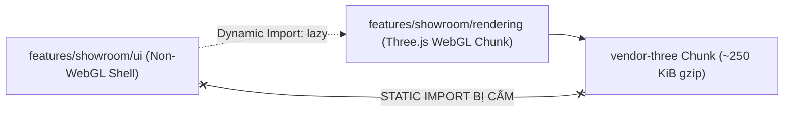

# Hướng Dẫn Kiến Trúc & Quy Tắc Dành Cho AI Coding Agents (AGENTS.md)

**Dự án:** Podium Effet De Sol (Podium EDS / F1-Overview)  
**Tài liệu tham chiếu:** [Architecture Overview](file:///docs/architecture/architecture-overview.md) | [ADR-001](file:///docs/decisions/ADR-001-feature-based-modular-architecture.md)

---

## 1. Nguyên Tắc Cốt Lõi (Core Principles)

Tất cả AI Coding Agents (Antigravity, Claude, Copilot, ChatGPT, v.v.) khi làm việc trên codebase này **BẮT BUỘC TUÂN THỦ** các quy tắc dưới đây. Không tự ý phá vỡ kiến trúc đã được định hình.

Hệ thống tuân thủ mô hình: **Modular Monolith + Feature-Based Architecture + Pragmatic Clean Architecture**.

---

## 2. Quy Tắc Ranh Giới Mô-đun (Module Boundaries & Directory Structure)

Mã nguồn được tổ chức theo tính năng nghiệp vụ (`features/`), không chia phẳng theo loại file kỹ thuật:

```text
src/
├── app/                  # Application bootstrap, root routes, top-level providers
├── features/             # Feature modules (showroom, championship, home, teams, drivers)
│   └── <feature_name>/
│       ├── ui/           # Presentation UI components (chỉ làm nhiệm vụ render giao diện)
│       ├── application/  # Custom hooks, local state orchestration, use cases
│       ├── domain/       # PURE business logic & rules (FIA points, thresholds)
│       ├── infrastructure/ # External API adapters, storage persistence
│       └── data/         # Static fixtures, schemas, seed metadata
├── shared/               # Reusable primitives (ui, hooks, lib, types)
└── i18n/                 # Localization dictionaries
```

### Các điều cấm tuyệt đối (Strict Prohibitions):

1. **Không tạo logic nghiệp vụ mới trong thư mục UI:**
   - Các phép tính điểm F1, luật tie-breaker, hoặc thuật toán đo đạc frame rate KHÔNG ĐƯỢC đặt trong UI components. Phải đặt trong `domain/` hoặc `application/`.
2. **Không gọi API trực tiếp từ Domain:**
   - Thư mục `domain/` phải là **Pure TypeScript**. Không được import `fetch`, `axios`, Vercel proxies, hay `localStorage` vào `domain/`.
3. **Quy tắc phụ thuộc một chiều (Dependency Inversion):**
   - `ui` -> `application` -> `domain` <- `infrastructure`.
   - Một feature không được import thành phần nội bộ (private components/utils) của một feature khác. Mọi giao tiếp liên feature phải thông qua public API hoặc chuyển vào `shared/`.

---

## 3. Quy Tắc Bất Khả Xâm Phạm Cho 3D Showroom (WebGL Isolation)

Showroom 3D là thành phần nặng nhất trong ứng dụng. Cấu trúc Showroom bắt buộc phải bảo toàn hiệu năng và quy tắc phân tách gói (bundle isolation):



1. **Tuyệt đối không rò rỉ WebGL vào Shell UI:**
   - Không được phép import tĩnh (`import ... from 'three'`) trong bất kỳ file nào thuộc `features/showroom/ui/`, `src/App.tsx`, hoặc `shared/`.
   - Toàn bộ Three.js, React Three Fiber (`@react-three/fiber`), và Drei (`@react-three/drei`) PHẢI nằm gọn sau ranh giới dynamic import:
     ```tsx
     const ShowroomScene = lazy(() =>
       import('./ShowroomScene').then((m) => ({ default: m.ShowroomScene })),
     );
     ```
   - **Phạm vi cho phép (Ranh giới hợp lệ trong Renderer):** Các tệp nằm trong tầng `rendering/` (như `ShowroomScene.tsx`, `F1Car3DModel.tsx`, `StudioW15Stage.tsx`, `CameraController.tsx`) **hoàn toàn được phép và cần thiết** import Three.js, R3F, Drei để phục vụ việc dựng hình. Quy tắc cấm WebGL ở đây chỉ áp dụng cho Shell UI bên ngoài Canvas.
2. **Phân biệt giữa Domain Logic và Canvas Components:**
   - [`showroomQuality.ts`](file:///src/components/showroom/showroomQuality.ts) là Pure TS (Profiles, DPR, thresholds) -> Đặt tại `performance/` hoặc `domain/`. File này an toàn để import ở cả Shell lẫn Scene.
   - [`ShowroomAdaptiveQualityMonitor.tsx`](file:///src/components/showroom/ShowroomAdaptiveQualityMonitor.tsx) dùng hook `useFrame` của R3F -> Bắt buộc nằm bên trong Canvas (tầng `rendering/` hoặc `performance/components/`). Tuyệt đối không import ra ngoài Shell!
3. **Kiểm tra tự động bắt buộc:**
   - Sau bất kỳ thay đổi nào liên quan đến Showroom, agent bắt buộc phải chạy:
     ```bash
     npm run build:check
     ```
     Script này sẽ xác minh: Initial bundle ≤ 180 KiB gzip VÀ Showroom shell không có static dependency tới WebGL.

---

## 4. Quy Tắc Clean Architecture Cho Championship & Dữ Liệu F1

1. **Tách rời 4 vai trò trong xử lý dữ liệu:**
   - **Infrastructure API Adapter:** Chịu trách nhiệm fetch dữ liệu từ Jolpica/OpenF1 và xử lý lỗi network, timeout, proxy path.
   - **Infrastructure Storage:** Chịu trách nhiệm đọc/ghi LocalStorage (`f1_detailed_results_v3`, metadata).
   - **Domain Rules Engine:** Tính toán điểm chặng theo bảng điểm FIA, tính điểm Sprint, giải quyết hòa điểm (tie-breaker), chuẩn hóa constructor IDs.
   - **Application Use Case:** Nhận yêu cầu từ UI/Store, gọi adapter lấy dữ liệu, đưa qua Domain engine tính toán, rồi lưu vào storage.
2. **Không để logic trong `data/`:**
   - Thư mục `data/` chỉ chứa mảng dữ liệu tĩnh (calendars, seed historical results). Logic biến đổi dữ liệu phải chuyển về `domain/` hoặc `application/`.

---

## 5. Quy Trình Kiểm Tra Bắt Buộc & Vai Trò QA (Verification Protocol)

Mọi thay đổi mã nguồn do AI Agent thực hiện đều phải vượt qua 4 chốt chặn kiểm thử tự động:

```bash
# 1. Kiểm tra cú pháp và quy chuẩn mã nguồn
npm run lint

# 2. Kiểm tra định dạng
npm run format:check

# 3. Chạy toàn bộ bộ test tự động (bắt buộc toàn bộ test suites PASS, không được làm hỏng test hiện có)
npm test

# 4. Kiểm tra build production và ngân sách kích thước bundle (< 180 KiB gzip)
npm run build:check
```

_Lưu ý về số lượng tests và metrics:_ Số lượng test suites và kích thước bundle được ghi nhận tại thời điểm baseline (tháng 10/2026: 41 test suites / 288 tests, bundle ~110 KiB gzip). Các con số này sẽ tiếp tục tăng trưởng theo các giai đoạn mở rộng tính năng, nhưng yêu cầu **100% tests PASS** và **Initial Bundle ≤ 180 KiB gzip** là quy chuẩn bất biến.

Nếu bất kỳ bước nào trong 4 bước trên thất bại, tác vụ được coi là **CHƯA HOÀN THÀNH**. Agent phải tự phân tích lỗi và sửa chữa cho đến khi tất cả các cổng kiểm thử đều hiển thị màu xanh (PASS).
