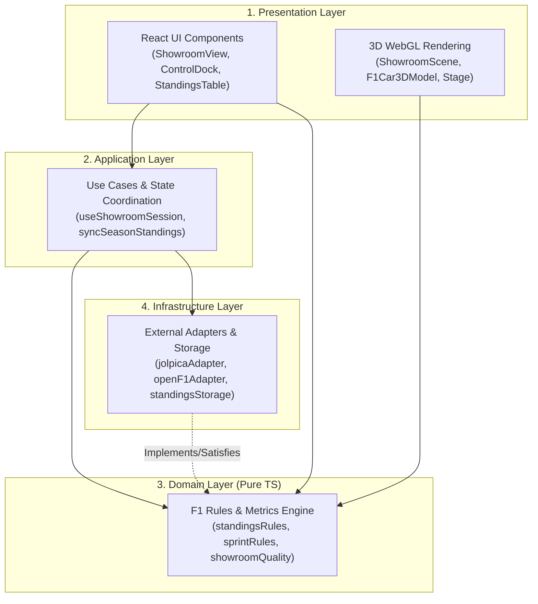
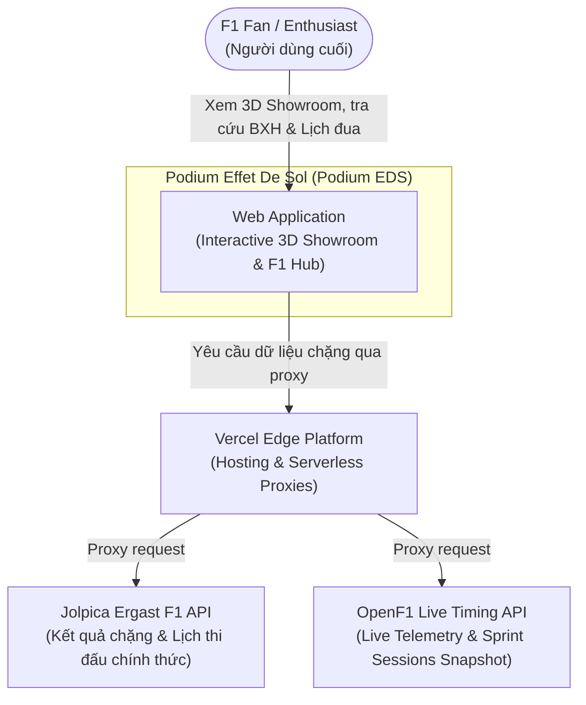
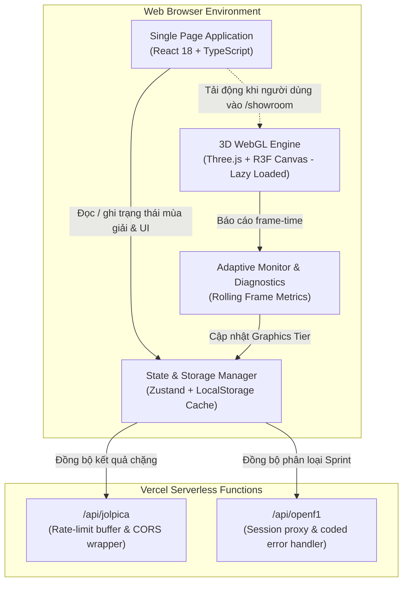
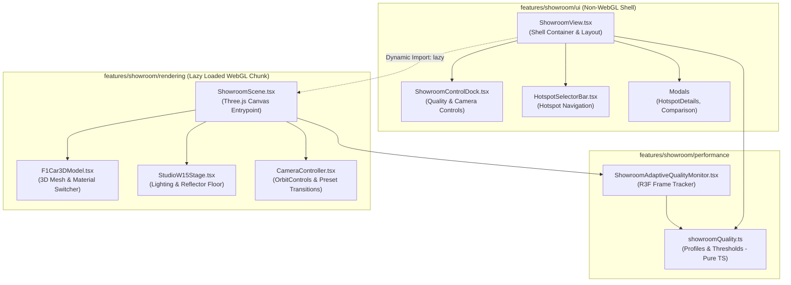

# Tổng Quan Kiến Trúc Hệ Thống (Architecture Overview)

**Dự án:** Podium Effet De Sol (Podium EDS / F1-Overview)  
**Mô hình định hướng:** Modular Monolith + Feature-Based Architecture + Pragmatic Clean Architecture  
**Trạng thái áp dụng:** Architecture Contract (Giai đoạn A2 — Chuẩn bị lộ trình chuyển dịch)

---

## 1. Giới Thiệu & Bối Cảnh

Podium Effet De Sol (Podium EDS) là một nền tảng kỹ thuật số tương tác chuyên sâu về kỷ nguyên xe đua Công thức 1 hiệu ứng mặt đất (Ground Effect Era 2022–2026). Dự án kết hợp:

1. **Interactive 3D Showroom:** Dựng hình thời gian thực xe đua F1 với vật liệu procedural, giải phẫu kỹ thuật (hotspots), hệ thống âm thanh và cơ chế tự động điều chỉnh chất lượng đồ họa thích ứng (**Adaptive Graphics Quality**).
2. **Championship & Standings Engine:** Tính toán và đồng bộ hóa bảng xếp hạng tay đua, đội đua theo chuẩn FIA kết hợp dữ liệu kép (Jolpica API & OpenF1 sprint live timing).
3. **High-Performance Web Client:** Đảm bảo thời gian tải trang nhanh, lazy loading tuyệt đối cho WebGL bundle và kiểm soát ngân sách bundle ban đầu dưới 180 KiB gzip.

Tài liệu này xác lập cấu trúc hiện tại, cấu trúc mục tiêu, phân chia các tầng trách nhiệm và định hướng quan hệ phụ thuộc nhằm đảm bảo hệ thống có thể mở rộng bền vững mà không bị suy giảm hiệu năng hoặc hồi quy logic.

---

## 2. Kiến Trúc Hiện Tại (As-Is Architecture)

Hiện tại, mã nguồn được tổ chức theo mô hình **Layer-Based Architecture** (phân chia theo phân loại kỹ thuật):

```text
F1-Overview/
├── api/                   # Vercel Serverless Functions (/api/jolpica, /api/openf1)
├── server/                # Server-side validation utilities (load test)
├── src/
│   ├── components/        # React UI & Three.js components (showroom, championship, pages, layout)
│   ├── data/              # Dữ liệu tĩnh, lịch thi đấu và OpenF1 sprint bridge
│   ├── services/          # f1DataService.ts, openF1Service.ts, standingsEngine.ts
│   ├── store/             # Zustand state management (championship, navigation)
│   ├── types/             # TypeScript definitions
│   ├── hooks/             # React custom hooks
│   ├── utils/             # Tiện ích chung (GPS, date, team colors, names, audio)
│   ├── i18n/              # Bản địa hóa (vi / en)
│   └── App.tsx            # Main router & top-level lazy loading
├── scripts/               # Đồng bộ dữ liệu, kiểm tra bundle, CDP benchmark
└── .github/workflows/     # CI/CD pipelines (Lint, Format, Tests, Bundle Check)
```

### Đánh giá kiến trúc hiện tại:

- **Ưu điểm:** Khởi đầu trực quan, dễ tiếp cận; hệ thống build Vite tối ưu tốt; phân tách lazy loading giữa UI và WebGL hoạt động hiệu quả qua script `scripts/check-showroom-bundle.mjs`.
- **Hạn chế khi quy mô tăng:**
  1. _Phân tán tính năng (Scattering):_ Khi bổ sung một tính năng cho Showroom hoặc Championship, lập trình viên phải chỉnh sửa rải rác ở `components/`, `data/`, `services/`, `store/`, và `types/`.
  2. _God Classes / Services:_ File `src/services/f1DataService.ts` (566 dòng) đang kết hợp cả gọi API HTTP, chuẩn hóa dữ liệu, lưu trữ LocalStorage và điều phối đồng bộ. Tương tự, `src/components/showroom/ShowroomView.tsx` (749 dòng) gánh quá nhiều trách nhiệm điều phối.
  3. _Lạc chỗ ranh giới nghiệp vụ:_ Logic tính điểm Sprint và sanitization (`openF1SprintBridge.ts`) nằm trong thư mục `src/data/championship/` thay vì tầng domain/business logic.

---

## 3. Kiến Trúc Mục Tiêu (Target Architecture)

Podium EDS hướng tới mô hình **Modular Monolith + Feature-Based Architecture + Pragmatic Clean Architecture**. Thay vì chia theo loại file kỹ thuật, hệ thống chia theo **tính năng nghiệp vụ (Features)**, và bên trong mỗi tính năng phức tạp sẽ phân tách các tầng trách nhiệm rõ ràng:

```text
src/
├── app/                              # Khởi động ứng dụng, định tuyến, providers
│   ├── App.tsx                       # Routing cấp cao & lazy loading boundaries
│   ├── providers/                    # ErrorBoundary, Analytics, Providers
│   └── router/                       # Cấu hình định tuyến
│
├── features/                         # Các mô-đun tính năng độc lập (Feature Modules)
│   │
│   ├── showroom/                     # MODULE 1: 3D Showroom & Graphics Engine
│   │   ├── ui/                       # [PRESENTATION] UI Shell, Buttons, Modals, Fallbacks
│   │   ├── rendering/                # [RENDERING] Three.js, R3F Canvas, Materials, Lights
│   │   ├── performance/              # [DOMAIN/PERF] Adaptive Profiles, Rolling Metrics, Monitor
│   │   ├── application/              # [APPLICATION] Showroom session & quality store/hooks
│   │   └── data/                     # [DATA] Hotspots, livery specs, per-team closeups
│   │
│   ├── championship/                 # MODULE 2: BXH & Kết quả giải đua F1
│   │   ├── ui/                       # [PRESENTATION] Standings tables, race classification
│   │   ├── application/              # [APPLICATION] Sync use-cases, refresh coordination
│   │   ├── domain/                   # [DOMAIN] Pure FIA rules, tie-breaker, sprint points
│   │   ├── infrastructure/           # [INFRASTRUCTURE] Jolpica/OpenF1 adapters, LocalStorage
│   │   └── data/                     # [DATA] Static race calendars, baseline cutoffs
│   │
│   ├── home/                         # MODULE 3: Trang chủ, multi-slice interactive canvas
│   ├── teams/                        # MODULE 4: Danh bạ và trang chi tiết đội đua
│   └── drivers/                      # MODULE 5: Danh bạ và trang chi tiết tay đua
│
├── shared/                           # Dùng chung giữa các features (không chứa business logic riêng)
│   ├── ui/                           # Navbar, Footer, Logo, Buttons, Common Cards
│   ├── hooks/                        # useAnimatedCounter, useReducedMotion, useReveal
│   ├── lib/                          # Date helpers, Audio engine, GPS calculation
│   └── types/                        # Core F1 types, ID definitions
│
└── i18n/                             # Chuỗi đa ngôn ngữ (vi, en)
```

---

## 4. Phân Chia 4 Tầng Trách Nhiệm (Clean Architecture Tinh Gọn)

Áp dụng cho các feature phức tạp (như `championship` và `showroom`):



### 1. Presentation Layer (Tầng hiển thị)

- **Nhiệm vụ:** Hiển thị giao diện người dùng, lắng nghe sự kiện tương tác (click, scroll, orbit camera) và dựng hình 3D WebGL.
- **Thành phần:** React components, canvas hooks, modal dialogs, layout fallbacks.
- **Ranh giới:** Không chứa quy tắc tính điểm FIA, không gọi API trực tiếp, không chứa thuật toán đo lường hiệu năng thuần túy.

### 2. Application Layer (Tầng ứng dụng / Điều phối)

- **Nhiệm vụ:** Điều phối luồng dữ liệu (orchestration), kết hợp giữa Domain rules và Infrastructure adapters; quản lý state cục bộ của use case.
- **Thành phần:** Custom hooks điều phối (`useShowroomSession`, `useChampionshipSync`), Zustand store slices.
- **Ranh giới:** Không phụ thuộc trực tiếp vào chi tiết DOM hay thư viện UI cụ thể; đóng vai trò cầu nối.

### 3. Domain Layer (Tầng nghiệp vụ cốt lõi)

- **Nhiệm vụ:** Chứa các quy tắc nghiệp vụ bất biến của F1 và thuật toán đánh giá hiệu năng:
  - Bảng điểm FIA (25-18-15-12-10-8-6-4-2-1, fastest lap rule).
  - Quy tắc phân loại Sprint (8-7-6-5-4-3-2-1).
  - Tiêu chí tie-breaker theo điều lệ thể thao F1.
  - Cấu hình chất lượng đồ họa và ngưỡng suy giảm/nâng cấp FPS (`showroomQuality.ts`).
- **Ranh giới bất khả xâm phạm:** **100% Pure TypeScript.** Tuyệt đối không import React, Three.js, Zustand, Axios/Fetch, hay LocalStorage.

### 4. Infrastructure Layer (Tầng hạ tầng & Kết nối)

- **Nhiệm vụ:** Giao tiếp với thế giới bên ngoài (external systems): Jolpica API, OpenF1 API, trình duyệt `window.localStorage`, Vercel edge endpoints.
- **Thành phần:** `jolpicaAdapter.ts`, `openF1Adapter.ts`, `standingsStorage.ts`.
- **Ranh giới:** Chịu trách nhiệm chuyển đổi dữ liệu thô (raw HTTP responses) thành Domain types sạch sẽ trước khi đưa vào ứng dụng.

---

## 5. Sơ Đồ Kiến Trúc C4 (C4 Model Diagrams)

### C4 Mức 1 — System Context Diagram

Mô tả Podium EDS trong mối tương quan với người dùng và các hệ sinh thái bên ngoài:



### C4 Mức 2 — Container Diagram

Mô tả các container logic tạo nên ứng dụng:



### C4 Mức 3 — Component Diagram (Module 3D Showroom)

Mô tả chi tiết cấu trúc tách biệt giữa UI Shell và 3D WebGL Canvas:



---

## 6. Ranh Giới Phụ Thuộc & Quy Tắc Hiệu Năng (Guiding Rules)

1. **Ranh giới cô lập WebGL (WebGL Isolation Boundary):**
   - Không một module nào ngoài `rendering/` được phép import trực tiếp thư viện `three`, `@react-three/fiber`, `@react-three/drei` bằng câu lệnh `import` tĩnh.
   - Initial bundle chỉ được tải phần Shell UI nhẹ; toàn bộ Three.js bundle (~250 KiB gzip) chỉ được tải khi người dùng truy cập trang `/showroom`.
2. **Quy tắc phụ thuộc một chiều (Unidirectional Dependency):**
   - `Presentation` phụ thuộc `Application` và `Domain`.
   - `Application` phụ thuộc `Domain` và `Infrastructure`.
   - `Domain` **không phụ thuộc bất kỳ ai** (Core business purity).
   - `Infrastructure` triển khai các interface được định nghĩa bởi `Domain` hoặc `Application`.
3. **Quy tắc kiểm thử độc lập (Testability):**
   - Toàn bộ tính toán điểm số F1 và thuật toán adaptive frame rate có thể chạy unit test trong môi trường Node.js mà không cần khởi tạo DOM ảo hay WebGL context.
